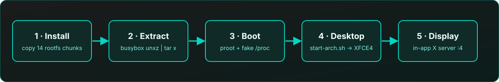
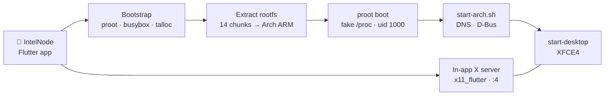

<div align="center">


<br>

[](https://github.com/DaRipper91/IntelNode/releases)
[](https://github.com/DaRipper91/IntelNode/actions/workflows/debug-build.yml)
[](https://github.com/DaRipper91/IntelNode/releases)
[](https://archlinuxarm.org/)
[](https://flutter.dev/)
[](COPYING)

**An Arch Linux ARM desktop on Android. No root, no Termux, one APK.**

[**⬇ Download**](https://github.com/DaRipper91/IntelNode/releases) &nbsp;·&nbsp;
[**📦 Install**](#-install) &nbsp;·&nbsp;
[**🧭 How it boots**](#-how-it-boots) &nbsp;·&nbsp;
[**🧪 Status**](#-status) &nbsp;·&nbsp;
[**🐞 Debugging**](debug/README.md)

</div>

---

IntelNode is a fork of [Cateners/tiny_computer](https://github.com/Cateners/tiny_computer) that swaps the
Debian rootfs for **Arch Linux ARM**. The app unpacks the system, boots it under `proot`, and shows the XFCE
desktop in an X server built into the app itself, so there is nothing to set up from a terminal.

> [!WARNING]
> **Work in progress.** Install and rootfs extraction work on a real phone. The final steps (X server and
> desktop on screen) are still being verified. See [Status](#-status) before you install.



## 📦 Install

1. Open the [**Releases**](https://github.com/DaRipper91/IntelNode/releases) page and download the newest `IntelNode-…-arm64.apk`.
2. **Uninstall any older IntelNode first.** Debug builds are signed with a different key each time, so Android refuses to update over them.
3. Allow installs from your browser or file manager, then install the APK.
4. Open the app and grant the storage permission when asked.
5. **Keep the app open** while it unpacks the system. The first run takes about 12 minutes.
6. The desktop opens when startup finishes.

> [!IMPORTANT]
> **Requirements:** an ARM64 Android phone and about 4 GB of free storage. The APK is large (about 1.4 GB)
> because the whole Arch rootfs ships inside it.

## 🧪 Status

Last tested on a **Pixel 10 Pro, Android 17 developer preview**.

| Stage | State |
|---|---|
| Install and rootfs chunk copy | ✅ works on device |
| Extraction (`busybox unxz \| tar x`) | ✅ works on device, about 12 min |
| Container boot (proot, fake `/proc`, `start-arch.sh`) | ✅ reaches the X server step |
| In-app X server | 🔧 fix shipped in `3e661ca`, awaiting device confirmation |
| XFCE desktop on screen | ❌ not yet observed |
| Browser (noVNC) / AVNC display | ❌ not wired for the Arch container |

Details and logs for each stage live in [`debug/`](debug/README.md) and [`AGENT_REPORT.md`](AGENT_REPORT.md).

## 🧭 How it boots



- **`start-arch.sh`** replaces systemd: it writes DNS from Android's settings, starts D-Bus, then runs the desktop as the `tiny` user.
- **`start-desktop`** starts the XFCE session against the X server socket.
- **Native tools** (`proot`, `busybox`, `tar`, `libtalloc`) ship as `libexec_*.so` inside the APK and are linked into the app's data directory at launch.
- **Arch-specific fixes** covered so far: `libtalloc.so.2` staging, the `alarm`/`tiny` uid swap, a dangling `resolv.conf`, and an absolute `xkb` symlink that points outside proot.

## 🧩 Extra containers (experimental)

**Settings → New Container** builds other distro and desktop combinations on the device by downloading a base
rootfs. The lists are config-driven (`lib/distros.dart`, `lib/desktop_environments.dart`). These use the same
in-app X11 model and are untested beyond their unit tests.

## 🛠️ Build from source

```bash
git clone https://github.com/DaRipper91/IntelNode.git
cd IntelNode
flutter pub get
flutter test
flutter build apk --debug --target-platform android-arm64
```

- Use **JDK 17–21**; the bundled Gradle 8.11 fails on JDK 25+.
- CI pins **Flutter 3.41.6**. Branches named `wip/**`, `rebase/**` or `debug/**` build a debug APK and attach it to the workflow run.
- Do not run `dart format` across the whole repo; it rewrites unrelated files.

## 📝 Changelog

<details open>
<summary><b>v2.2.6 debug builds</b> — Arch boot on a real device</summary>

- **Fix:** `libtalloc.so.2` is staged so `proot` starts.
- **Fix:** extraction failures are reported instead of showing "Installation Complete".
- **Fix:** startup no longer waits forever on PulseAudio.
- **Fix:** `tiny` is uid 1000, `su` no longer asks for a password, `resolv.conf` is replaced, `start-desktop` runs through bash.
- **Fix:** fake `/proc` files and `cap_last_cap` for proot; the Termux `/tmp` bind is gone.
- **Fix:** the in-app X server uses the real `xkeyboard-config-2` directory.
- **Branding:** loading caption is "IntelNode".
</details>

<details>
<summary><b>v2.2.5</b> — multi-distro builder</summary>

- On-device multi-distro and multi-desktop container builder, installer with dry-run planning, and a New Container wizard.
- Rootfs XZ extraction fix, applib link errors surfaced, new app icon.
</details>

<details>
<summary><b>v2.1.x</b></summary>

- Two-stage bootstrap, Android 13–16 storage permission flow, `LateInitializationError` fix.
</details>

## Credits

- [**Cateners/tiny_computer**](https://github.com/Cateners/tiny_computer) — the upstream project this forks.
- [**Termux**](https://termux.dev/en/) and [**termux-x11**](https://github.com/termux/termux-x11) — `proot`, `busybox` and the X server core.
- [**Arch Linux ARM**](https://archlinuxarm.org/) — the rootfs.

## License

[GNU General Public License v3.0](COPYING)
