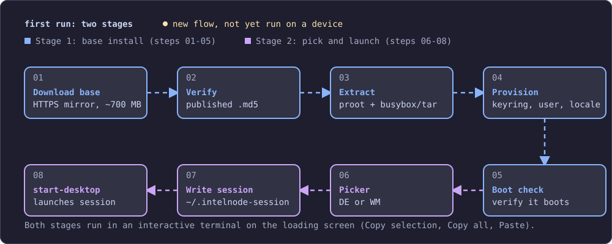
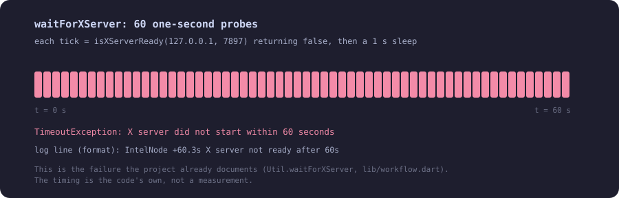
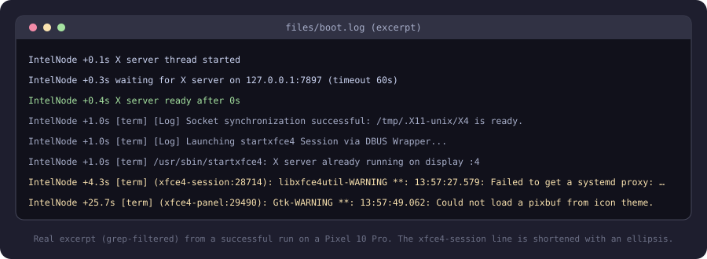

<div align="center">


<br>

[](https://github.com/DaRipper91/IntelNode/releases)
[](#requirements)
[](COPYING)

</div>

IntelNode is a fork of [Cateners/tiny_computer](https://github.com/Cateners/tiny_computer). It is a Flutter app that runs Arch Linux ARM in proot on Android. No root, one APK, no Termux. The desktop is shown through an X server built into the app (x11_flutter, termux-x11 core).

> [!WARNING]
> The new two-stage first run (commit `e7e05f9` on `main`) has **not been verified on a device**. The XFCE desktop appearing on screen has not been observed yet. See [Status](#status).

<div align="center">

</div>

## Contents

- [How first run works](#how-first-run-works)
- [Inside the sandbox](#inside-the-sandbox)
- [Requirements](#requirements)
- [Install](#install)
- [Status](#status)
- [Reading a failed boot](#reading-a-failed-boot)
- [Repo layout](#repo-layout)
- [Build from source](#build-from-source)
- [Credits and license](#credits-and-license)

## How first run works

Two stages, both run in an interactive terminal on the loading screen (Copy selection, Copy all and Paste buttons).

<div align="center">

</div>

<details>
<summary><b>Stage 1: base install</b></summary>

<br>

1. Download the bare Arch Linux ARM base over HTTPS from a mirror.
2. Verify the published `.md5`.
3. Extract with proot + busybox/tar.
4. Provision: `pacman-key` archlinuxarm keyring, user `tiny` (uid 1000, in `wheel`, passwordless sudo), locale, pacman tweaks for proot.
5. Verify the container boots.

</details>

<details>
<summary><b>Stage 2: pick a session</b></summary>

<br>

A picker with two sections:

| Section | Options |
|---|---|
| Desktop Environments | XFCE4, LXQt, MATE |
| Window Managers | i3, Openbox, Fluxbox, IceWM |

niri and COSMIC (Wayland) are listed but disabled as previews. The chosen session is written to `~/.intelnode-session`, and `start-desktop` launches it.

<div align="center">

</div>

The image is an illustrative mock, not a screenshot.

</details>


## Inside the sandbox

Six layers sit between the phone's kernel and the desktop. Everything above the app sandbox runs unprivileged, so each layer is something proot has to fake or something Android has to allow.

<div align="center">

</div>

What the cross-section is built from, all observed over adb on a Pixel 10 Pro (Android 17 developer preview) on 2026-11-15:

| Observation | Where it came from |
|---|---|
| The app runs in SELinux domain `untrusted_app_34`, enforcing | audit lines in logcat |
| Executing guest binaries (`bash`, `ld-linux-aarch64.so.1`, `cp`, ...) from the app data directory is **granted** | `avc: granted { execute }` audit lines |
| proot's `setattr` on `/proc` and `/sys` directories is **denied**, and proot keeps running anyway | audit lines; one 8.6-minute proot run drew hundreds of them and survived |
| The extracted Arch rootfs is about 2.8 GiB from a 791 MiB tar | `du` and file size on the device |
| The X server is a TCP listener on `127.0.0.1:7897` (`1ED9` in `/proc/net/tcp`) | `Util.waitForXServer` in `lib/workflow.dart` |

The top layer is dashed on purpose: the XFCE session has not been seen on screen yet.


## Requirements

- An ARM64 Android phone.
- Network on first run. The base is roughly 700 MB and the desktop a few hundred MB more; exact sizes vary.
- Last device tested: Pixel 10 Pro on the Android 17 developer preview.

## Install

Grab a build from [Releases](https://github.com/DaRipper91/IntelNode/releases). Pre-releases are debug builds. `v2.2.6-debug.2` exists but predates the two-stage flow.

<details>
<summary><b>Steps</b></summary>

<br>

1. Uninstall any older IntelNode first. Signing keys differed per CI build; from the next build on, CI signs with a stable key so upgrades work.
2. Allow installs from unknown sources.
3. Install the APK.
4. Grant the storage permission.
5. Keep the app open during first run.

</details>

Extra containers: Settings -> New Container builds other distro/desktop combinations on the device (experimental).

## Status

<div align="center">

</div>

- The previous bundled-rootfs flow got through install, extraction and boot up to the in-app X server on the Pixel 10 Pro.
- The new two-stage flow has not yet run on hardware.
- The XFCE desktop appearing on screen has not been observed.
- The browser noVNC / AVNC display path is not wired for the Arch container.

One real first run, reconstructed from adb timestamps. The build on the phone was the bundled-rootfs flow, not the new two-stage one, and the stage names are inferred from timing:

<div align="center">

</div>

If a boot fails, [`debug/`](debug/) has `capture.sh` and a README for diagnosing it. Logs are git-ignored.


## Reading a failed boot

The known failure is the last visible stage: the app polls the in-app X server for 60 seconds and gives up.

<div align="center">

</div>

Until recently the container terminal wrote only to the on-screen xterm, so a failed boot left almost nothing in logcat. Since commit `ad49a08` (hardened in `ab6e2d9`) the terminal output, shell exit codes and the X server launch and wait events are mirrored to logcat (prefix `IntelNode`) and to a rolling `files/boot.log`:

```sh
adb logcat -d | grep IntelNode
adb shell run-as com.daripper91.daripped cat files/boot.log   # debuggable builds only
debug/capture.sh <serial>                                     # full logcat + process/port state every 15 s (restarts the app)
```

<div align="center">

</div>

The card above is **illustrative**: the line formats are the real ones from `lib/boot_log.dart`, but this output has not been captured from a device yet, because no build containing the logging has been installed. Logcat lines go through Flutter's throttled `debugPrint`, so they can lag and the last ones may be lost if the process dies; `boot.log` is written synchronously and is the reliable record.

| Line | Means |
|---|---|
| `workflow started` / `launching container N` | startup reached the container launch |
| `[term] ...` | one line of the container terminal's output |
| `shell finished with exit code N` | a helper shell (extraction, provisioning) ended |
| `launching X server (xkb root: ...)` | the in-app X server was started |
| `waiting for X server on 127.0.0.1:7897 (timeout 60s)` | the 60-second probe began |
| `X server not ready after 60s (launch failed: ...)` | the probe gave up; the reason, if any, follows |
| `terminal pty exited with exit code N` | the container's terminal process ended |

## Repo layout

<details>
<summary><b>Where things live</b></summary>

<br>

| Path | Role |
|---|---|
| `lib/workflow.dart` | App workflow |
| `lib/container_installer.dart` | Container install |
| `lib/distros.dart` | Distro definitions |
| `lib/desktop_environments.dart` | Desktop and window manager definitions |
| `lib/desktop_picker.dart` | Stage 2 picker |
| `lib/setup_session.dart` | Setup session |
| `lib/setup_terminal.dart` | Interactive setup terminal |
| `lib/boot_log.dart` | Mirrors boot and X server output to logcat and `files/boot.log` |
| `test/boot_log_test.dart` | Tests for `BootLog` |
| `images/` | README artwork (animated SVG) |
| `assets/scripts/` | `start-arch.sh`, `start-desktop` |
| `debug/` | `capture.sh` and README for failed-boot diagnosis |
| `AGENT_REPORT.md` | Agent report |

</details>

## Build from source

```sh
git clone https://github.com/DaRipper91/IntelNode.git
cd IntelNode
flutter pub get
flutter test
flutter build apk --debug --target-platform android-arm64
```

CI pins Flutter 3.41.6. JDK 17-21 is needed. Pushes to `wip/**`, `rebase/**` and `debug/**` branches build a debug APK artifact.

## Credits and license

- [Cateners/tiny_computer](https://github.com/Cateners/tiny_computer), the project this forks.
- [Termux](https://termux.dev) and termux-x11, the basis of the in-app X server.
- [Arch Linux ARM](https://archlinuxarm.org).

Licensed under the GNU General Public License v3.0. See [COPYING](COPYING).
