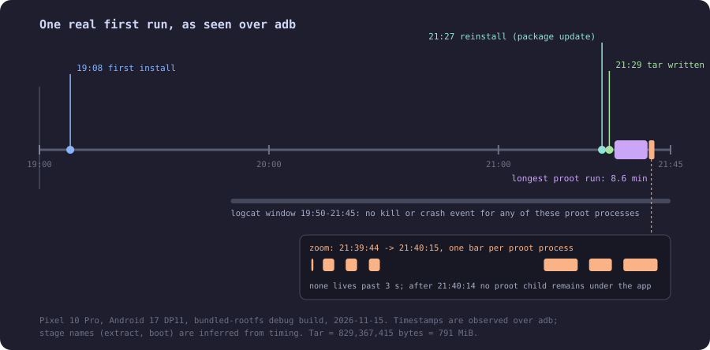

<div align="center">



<br>

[](https://github.com/DaRipper91/IntelNode/releases)
[](#requirements)
[](COPYING)

</div>

IntelNode is a fork of [Cateners/tiny_computer](https://github.com/Cateners/tiny_computer). It is a Flutter app that runs a Linux distribution in proot on Android: Arch Linux ARM (the default), Ubuntu, Debian, Fedora, openSUSE, Alpine, Void or Kali, chosen on first run. No root, one APK, no Termux. The desktop is shown through an X server built into the app (x11_flutter, termux-x11 core).

> [!WARNING]
> This is a pre-release. On 2026-11-20 the first run was exercised on a Nothing Phone 2a (Android 16) with XFCE4 on seven of the eight distros, and the desktop was seen on screen for all seven; openSUSE's panel died once after about 11 minutes. Kali has not been tested. The Pixel 10 Pro has not been re-tested with the latest fixes. See [Status](#status) for the per-distro results and the known issues.

<div align="center">

</div>

## Contents

- [How first run works](#how-first-run-works)
- [Inside the sandbox](#inside-the-sandbox)
- [Requirements](#requirements)
- [Install](#install)
- [Status](#status)
- [Reading a failed boot](#reading-a-failed-boot)
- [Repo layout](#repo-layout)
- [Build from source](#build-from-source)
- [Credits and license](#credits-and-license)

## How first run works

Two stages, both run in an interactive terminal on the loading screen (Copy selection, Copy all and Paste buttons).

<div align="center">

</div>

<details>
<summary><b>Stage 1: pick a distribution and install the base</b></summary>

<br>

1. A picker lists the eight distributions, Arch Linux ARM first.
2. Download the rootfs over HTTPS: Arch from an ArchLinuxARM mirror, Ubuntu from Canonical's cloud images, Debian, Fedora, openSUSE, Alpine and Void from [termux/proot-distro](https://github.com/termux/proot-distro) release tarballs, Kali through the linuxcontainers.org image server.
3. Verify the checksum where the source publishes one: Arch's `.md5` and Ubuntu's `SHA256SUMS`. The proot-distro tarballs had no published checksum on the builds tested (see [Known issues](#status)).
4. Extract with proot + busybox/tar.
5. Provision: user `tiny` (uid 1000, passwordless sudo), locale, and per-distro tweaks for proot (Arch also gets the `pacman-key` archlinuxarm keyring and `wheel`).
6. Verify the container boots.

</details>

<details>
<summary><b>Stage 2: pick a session</b></summary>

<br>

A picker with two sections:

| Section | Options |
|---|---|
| Desktop Environments | XFCE4, LXQt, MATE, LXDE, Enlightenment, Cinnamon |
| Window Managers | i3, Openbox, Fluxbox, IceWM, awesome, bspwm |

The chosen session is written to `~/.intelnode-session`, and `start-desktop` launches it. Only XFCE4 has been tested on every distribution (see [Status](#status)); the other sessions are defined in `lib/desktop_environments.dart` but have not been run on a device.

<div align="center">

</div>

The image is an illustrative mock, not a screenshot, and may not list every session.

</details>


## Inside the sandbox

Six layers sit between the phone's kernel and the desktop. Everything above the app sandbox runs unprivileged, so each layer is something proot has to fake or something Android has to allow.

<div align="center">

</div>

What the cross-section is built from, all observed over adb on a Pixel 10 Pro (Android 17 developer preview) on 2026-11-15:

| Observation | Where it came from |
|---|---|
| The app runs in SELinux domain `untrusted_app_34`, enforcing | audit lines in logcat |
| Executing guest binaries (`bash`, `ld-linux-aarch64.so.1`, `cp`, ...) from the app data directory is **granted** | `avc: granted { execute }` audit lines |
| proot's `setattr` on `/proc` and `/sys` directories is **denied**, and proot keeps running anyway | audit lines; one 8.6-minute proot run drew hundreds of them and survived |
| The extracted Arch rootfs is about 2.8 GiB from a 791 MiB tar | `du` and file size on the device |
| The X server is a TCP listener on `127.0.0.1:7897` (`1ED9` in `/proc/net/tcp`) | `Util.waitForXServer` in `lib/workflow.dart` |

The top layer is dashed because, when the diagram was drawn, the XFCE session had only been seen through `ps`. The desktop has since been seen on screen on a Nothing Phone 2a (see [Status](#status)).


## Requirements

- An ARM64 Android phone.
- Network on first run. Sizes depend on the distribution: Arch's rootfs is about 790 MB and its XFCE4 packages about 135 MiB, Ubuntu's rootfs about 206 MB; the others vary.
- A network that can reach the distribution's mirrors. On one Wi-Fi without working IPv6, Void's default mirror and Kali's image server were unreachable (see [Status](#status)).
- Devices tested: Pixel 10 Pro (Android 17 developer preview) and Nothing Phone 2a (Android 16, kernel 5.15, 4 KB pages).

## Install

Grab a build from [Releases](https://github.com/DaRipper91/IntelNode/releases). Pre-releases are debug builds. `v2.2.6-debug.2` exists but predates the two-stage flow.

<details>
<summary><b>Steps</b></summary>

<br>

1. Builds from commit `3f70dbf` on are signed with a stable key from repo secrets, so they upgrade in place (`adb install -r`). Uninstall first only if you have an older build, which was signed with a different key each time.
2. Allow installs from unknown sources.
3. Install the APK.
4. When asked, allow "All files access" (Android opens its settings screen) and notifications. On Android 13 and later the notification prompt can appear over the desktop until you answer it.
5. Keep the app open during first run.

</details>

On first run the app asks which distribution to install. Settings -> New Container builds other distro/desktop combinations on the device (experimental). Distros defined in `lib/distros.dart`: Arch Linux ARM, Ubuntu, Debian, Fedora, openSUSE, Alpine, Void and Kali. Installed containers are listed in the Containers tab. The first container is the default and cannot be deleted from the app, and neither can a container that is running; to start over, clear the app's data in Android settings.

## Status

<div align="center">

</div>

**Tested 2026-11-20 on a Nothing Phone 2a** (Android 16), XFCE4 only, builds from the `fix/proot-safe-distro-installs` branch (PR #35). Times are rough and depend on the network.

| Distribution | XFCE4 install | Result on the phone |
|---|---|---|
| Arch Linux ARM | about 14 min | Boots with panel, dock and icons. |
| Ubuntu 24.04 | about 4 min | Boots. Not re-run since the later apt changes. |
| Debian 12 | about 5 min | Boots. |
| Fedora 40 | about 5.5 min | Boots. |
| openSUSE Leap 16 | about 4 min | Boots, but the panel died once about 11 minutes in; after a full app restart it came back, and longer-term stability is unconfirmed. |
| Alpine 3.22 | about 1.5 min | Boots; the dock launchers all show a generic gear icon (no icon theme in the package list). |
| Void | about 4 min | Boots with panel, dock and icons; watched for about a minute. |
| Kali | not run | Its image server (`images.linuxcontainers.org`) failed with "Network is unreachable" from the test network. |

Findings from this round (each reproduced on the phone, fixed, and re-run there): the Arch download could never succeed because its mirror URLs had mismatched TLS certificates or no DNS record; Debian's apt unpack replaced the `/lib -> usr/lib` symlink and later lost its icon caches; openSUSE needed a corrected zypper command, tolerance for a skipped repository (exit 106), and a `dbus-daemon` because Leap 16 ships `dbus-broker`; Void's default mirror timed out and its package index had to be synced and `xbps` updated first.

**Known issues**

- openSUSE: the XFCE panel and its plugin host died together about 11 minutes into a session, and the session D-Bus stopped answering new clients afterwards. The cause is not known; the container writes no `~/.xsession-errors`.
- Pixel 10 Pro: after backing out of the X11 screen into the app, the play button reopens X11, which reports that nothing is connected. A log captured on the phone shows Android freezing the separate `:x11` process while it is in the background; the cause is not confirmed.
- The proot-distro tarballs (Debian, Fedora, openSUSE, Alpine, Void) were installed without checksum verification on the builds tested. PR #36 adds pinned SHA-256 values for them; those have not been run on a device yet.
- Only XFCE4 has been tested. The Pixel 10 Pro has not been re-tested with the fixes above.

Earlier result on a Pixel 10 Pro, kept for history:

- The two-stage flow (download with resume, md5, extract, provision, picker, XFCE4 install, session file) ran end to end on a Pixel 10 Pro, build `6133f9c`, CI run 43879730575.
- On that build `xfce4-session`, `xfwm4`, `xfce4-panel`, `xfsettingsd`, Thunar and a session dbus were running, with no ANR and no `Function not implemented` errors in `boot.log`. This comes from the on-device debugging session's report; I have not re-checked it on the phone.
- A later commit (`172c51d`) records the XFCE desktop as verified on screen on the device; I have not re-checked that on the phone. Known follow-ups: an icon theme package looks missing, and `am start` on a running app re-runs the workflow and starts the X server twice.
- The browser noVNC / AVNC display path is not wired for the Arch container.

One earlier first run, reconstructed from adb timestamps. The build on the phone then was the old bundled-rootfs flow, not the two-stage one, and the stage names are inferred from timing:

<div align="center">

</div>

If a boot fails, [`debug/`](debug/) has `capture.sh` and a README for diagnosing it. Logs are git-ignored.


## Reading a failed boot

Three boot failures have been found on a real device so far. Each one looks different in the log:

| Failure | Signature | Cause and fix |
|---|---|---|
| X server never answers | `X server not ready after 60s`, after the probe below | The xkb symlink bug (`3e661ca`): the X server was pointed at a missing xkb directory. Fixed. |
| App killed ~25 s after the X11 page opens | logcat `am_anr` "Input dispatching timed out", then `bg anr`; the ANR trace shows the UI thread in `com.termux.x11.CmdEntryPoint.main` -> `Looper.loop()` | x11_flutter ran the X server's looper on the main thread. `MainActivity` now starts it on its own thread by reflection and reports failures back as `xServerLaunchFailed`. Fixed in `6133f9c`'s tree; only process state was checked afterwards. |
| Desktop never starts, dbus dies | `cd: /: Function not implemented`, `dbus-daemon: Could not chdir() to root directory`, `EOF reading PID from bus daemon` | `PROOT_NO_SECCOMP=1` in the boot command made every `chdir`/`getcwd` return ENOSYS. Removing it fixed it. |

The probe behind the first row is a 60 second poll of the in-app X server's TCP port:

<div align="center">

</div>

Until recently the container terminal wrote only to the on-screen xterm, so a failed boot left almost nothing in logcat. Since commit `ad49a08` (hardened in `ab6e2d9`) the terminal output, shell exit codes and the X server launch and wait events are mirrored to logcat (prefix `IntelNode`) and to a rolling `files/boot.log`:

```sh
adb logcat -d | grep IntelNode
adb shell run-as com.daripper91.daripped cat files/boot.log   # debuggable builds only
debug/capture.sh <serial>                                     # full logcat + process/port state every 15 s (restarts the app)
```

<div align="center">

</div>

The card above is a **real, grep-filtered excerpt** of `files/boot.log` from a successful boot on the Pixel 10 Pro, pulled by the on-device debugging session (one long line is shortened with an ellipsis). It shows a healthy boot, so the X server answers on the first probe (`ready after 0s`); the failure signatures are in the table above. The two warnings at the end are known: a missing systemd proxy, and an icon theme that looks absent. Logcat lines go through Flutter's throttled `debugPrint`, so they can lag and the last ones may be lost if the process dies; `boot.log` is written synchronously and is the reliable record.

| Line | Means |
|---|---|
| `workflow started` / `launching container N` | startup reached the container launch |
| `[term] ...` | one line of the container terminal's output |
| `shell finished with exit code N` | a helper shell (extraction, provisioning) ended |
| `launching X server (xkb root: ...)` | the in-app X server was started |
| `waiting for X server on 127.0.0.1:7897 (timeout 60s)` | the 60-second probe began |
| `X server not ready after 60s (launch failed: ...)` | the probe gave up; the reason, if any, follows |
| `terminal pty exited with exit code N` | the container's terminal process ended |

## Repo layout

<details>
<summary><b>Where things live</b></summary>

<br>

| Path | Role |
|---|---|
| `lib/workflow.dart` | App workflow |
| `lib/container_installer.dart` | Container install |
| `lib/distros.dart` | Distro definitions |
| `lib/desktop_environments.dart` | Desktop and window manager definitions |
| `lib/desktop_picker.dart` | Stage 2 picker |
| `lib/setup_session.dart` | Setup session |
| `lib/setup_terminal.dart` | Interactive setup terminal |
| `lib/boot_log.dart` | Mirrors boot and X server output to logcat and `files/boot.log` |
| `test/boot_log_test.dart` | Tests for `BootLog` |
| `images/` | README artwork (animated SVG) |
| `assets/scripts/` | `start-arch.sh`, `start-desktop` |
| `debug/` | `capture.sh` and README for failed-boot diagnosis |
| `AGENT_REPORT.md` | Agent report |

</details>

## Build from source

```sh
git clone https://github.com/DaRipper91/IntelNode.git
cd IntelNode
flutter pub get
flutter test
flutter build apk --debug --target-platform android-arm64
```

CI pins Flutter 3.41.6. JDK 17-21 is needed. Pushes to `wip/**`, `rebase/**` and `debug/**` branches build a debug APK artifact.

## Credits and license

- [Cateners/tiny_computer](https://github.com/Cateners/tiny_computer), the project this forks.
- [Termux](https://termux.dev) and termux-x11, the basis of the in-app X server.
- [Arch Linux ARM](https://archlinuxarm.org).
- [termux/proot-distro](https://github.com/termux/proot-distro), whose release tarballs are the Debian, Fedora, openSUSE, Alpine and Void rootfs images.

Licensed under the GNU General Public License v3.0. See [COPYING](COPYING).
