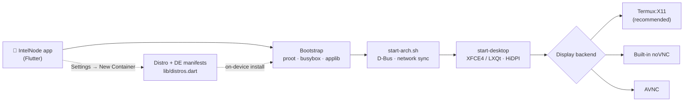

<div align="center">


<br>

[](https://github.com/DaRipper91/IntelNode/releases/latest)
[](https://github.com/DaRipper91/IntelNode/actions/workflows/flutter-build.yml)
[](https://github.com/DaRipper91/IntelNode/releases/latest)
[](https://archlinuxarm.org/)
[](https://flutter.dev/)
[](COPYING)
[](MANUAL.md)

**A complete, high-performance Arch Linux ARM workstation on Android — no root required.**

[**⬇ Download**](https://github.com/DaRipper91/IntelNode/releases/latest) &nbsp;·&nbsp;
[**📦 Install**](#-installation) &nbsp;·&nbsp;
[**🛠 Architecture**](#%EF%B8%8F-architecture) &nbsp;·&nbsp;
[**📝 Changelog**](#-changelog) &nbsp;·&nbsp;
[**📖 Manual**](MANUAL.md)

</div>

---

Highly optimized for modern ARM64 hardware (Pixel 10 Pro / Tensor G5) and designed for intelligence professionals and power users. This is a specialized fork of [Cateners/tiny_computer](https://github.com/Cateners/tiny_computer), migrated to a rolling-release Arch Linux base with advanced security bypasses for Android 16 (Cinnamon Bun).

> [!NOTE]
> **v2.2.5** adds an on-device **multi-distro / multi-desktop container builder**.
> Open **Settings → New Container** to build extra distro + desktop combinations without
> shipping a rootfs for each one. See [Additional Containers](#-features) below.

## 🧭 Contents

- [Features](#-features)
- [Installation](#-installation)
- [Architecture](#%EF%B8%8F-architecture)
- [Changelog](#-changelog)
- [Building from Source](#%EF%B8%8F-building-from-source)
- [Credits](#credits) · [License](#license)

---

## 🚀 Features

| | |
|---|---|
| 🐧 **Full Arch Linux ARM** | Access to `pacman`, AUR support, and a rolling-release ecosystem optimized for the latest Cortex-X925 cores. |
| 🔓 **God Mode Protocol** | Shizuku + `rish` leverage ADB-level permissions to bypass standard Android sandboxing — faster rootfs extraction, process priority boosting (`renice`), and kernel-level performance tweaks. |
| 🤖 **Modern Android Compatibility** | Tuned for **Android 16+** with `PROOT_NO_SECCOMP=1` to bypass new ptrace restrictions. |
| 🎮 **Hardware Acceleration** | Smooth graphical performance via VirGL/Mali-G925 passthrough. |
| 🔊 **Advanced Audio** | High-fidelity PipeWire/PulseAudio pipeline for low-latency sound. |
| 🕵️ **Intelligence Workflow** | Built-in templates for knowledge ingestion, Obsidian-ready vaults, and high-speed Rust-based CLI tools (`ripgrep`, `fd`, `fzf`). |

### 🖥️ Flexible Display Backends

- [**Termux:X11**](https://github.com/termux/termux-x11) — Native X11 passthrough for maximum performance (**Recommended**).
- **Built-in noVNC** — Integrated WebView client that works out of the box.
- [**AVNC**](https://github.com/gujjwal00/avnc) — Support for native Android VNC clients.

### 🧩 Additional Containers (Experimental)

Build extra distro + desktop combinations on-device from **Settings → New Container**,
downloading a base rootfs and installing the chosen desktop directly rather than shipping
one per combination. The distro and desktop lists are config-driven manifests
(`lib/distros.dart`, `lib/desktop_environments.dart`); see those files for exactly which
combinations are currently available and which ones are flagged experimental. Desktops
installed this way follow the same X11-over-Termux:X11 model as the bundled Arch container;
Wayland compositors are preview-only until a nested compositor bridge is prototyped.

---

## 📦 Installation

1. Visit the [**Latest Release**](https://github.com/DaRipper91/IntelNode/releases/latest).
2. Download `app-arm64-v8a-release.apk`.
3. Enable **"Install from unknown sources"** in your Android Settings.
4. Install and launch the app.
5. **Grant Storage Permissions** when prompted (required for the Linux container).
6. Wait for the bootstrap process (5–15 minutes).
7. Your Arch Linux desktop will appear!

> [!IMPORTANT]
> **Requirements:** Android 10+ (Android 15/16 recommended), ARM64 device, ~4 GB free storage.

---

## 🛠️ Architecture

IntelNode uses a custom two-stage bootstrap system to bypass the lack of `systemd` in proot environments:

1. **`start-arch.sh`**: Handles low-level initialization, D-Bus bus generation, and network synchronization.
2. **`start-desktop`**: Orchestrates the graphical session (XFCE4/LXQt), display socket synchronization, and HiDPI scaling.



---

## 📝 Changelog

<details open>
<summary><b>v2.2.x</b> — multi-distro builder &amp; bootstrap hardening (Latest: v2.2.5)</summary>

- **New (v2.2.5):** Multi-distro / multi-DE on-device container builder — config-driven distro and desktop manifests, a container installer with dry-run planning, and a New Container setup wizard in Settings.
- **Fix:** Rootfs XZ extraction.
- **Fix:** Bootstrap exit-127 error and X11 startup crash; busybox now resolves its real binary and dependency instead of the broken Termux applet stub.
- **Fix:** Applib link failures are surfaced with the real error, `MANAGE_EXTERNAL_STORAGE` is checked, and LXQt boots correctly on the VNC path.
- **Branding:** New IntelNode app icon; project references renamed from DaRipped Tiny Computer to IntelNode.
- **CI:** `flutter test` and SDK license acceptance added to the build; silent failure masking removed.

</details>

<details>
<summary><b>v2.1.1</b></summary>

- **Fix:** Resolved `LateInitializationError` crash on startup.
- **Fix:** Improved storage permission request flow for Android 13-16.
- **Maintenance:** Consolidated repository branches and updated documentation.

</details>

<details>
<summary><b>v2.1.0</b></summary>

- **New:** Two-stage bootstrap system for better stability.
- **Fix:** Android 16 (Cinnamon Bun) stability patches.
- **Performance:** GZIP-based rootfs chunks for faster extraction.

</details>

---

## 🏗️ Building from Source

```bash
git clone https://github.com/DaRipper91/IntelNode.git
cd IntelNode
flutter pub get
flutter build apk --release --target-platform android-arm64 --split-per-abi
```

> [!TIP]
> Build with **JDK 17–21** (CI uses 17). The bundled Gradle 8.11 fails on very new system
> JDKs (25+) with `Unsupported class file major version`. Branches named `wip/**`, `rebase/**` or `debug/**`
> build a debug APK in CI and attach it as a workflow artifact — no release is published.

---

## Credits

- [**Cateners/tiny_computer**](https://github.com/Cateners/tiny_computer) — The original upstream project.
- [**Termux**](https://termux.dev/en/) — `proot`, `busybox`, and X11 tooling.
- [**Arch Linux ARM**](https://archlinuxarm.org/) — The rolling-release base.

---

## License

[GNU General Public License v3.0](COPYING)
